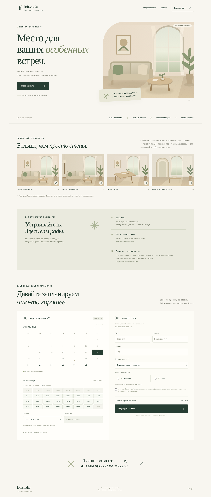
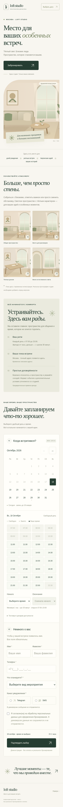
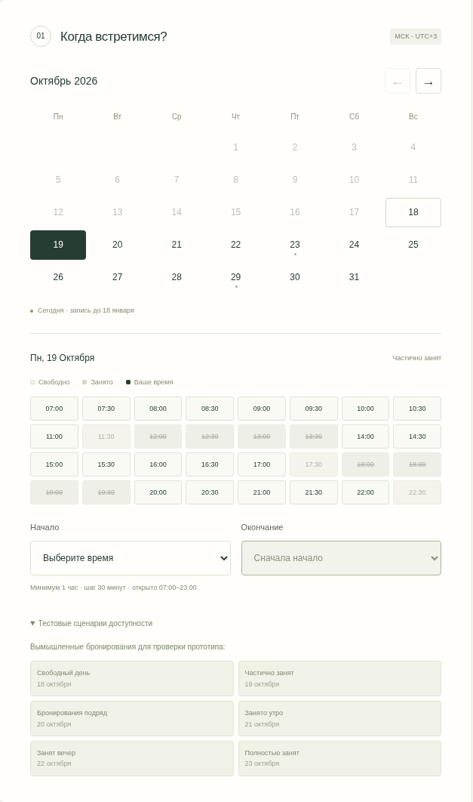
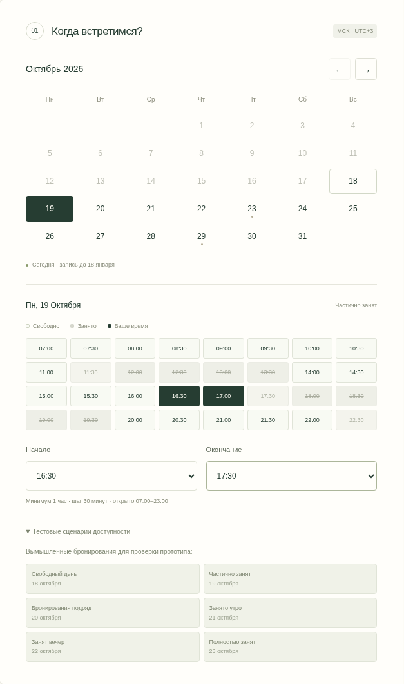
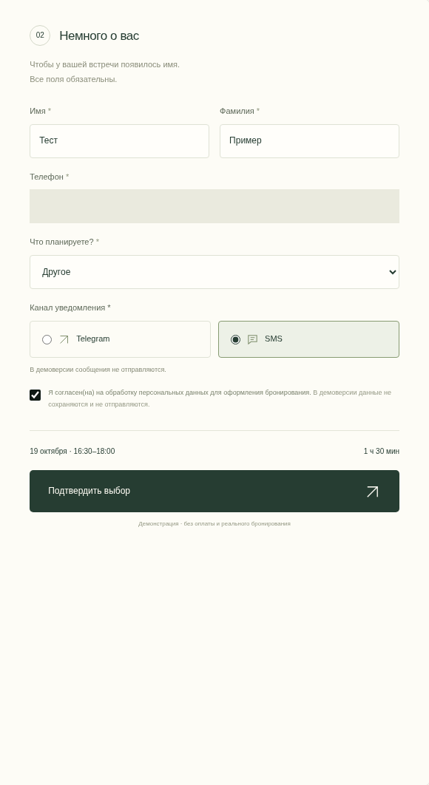
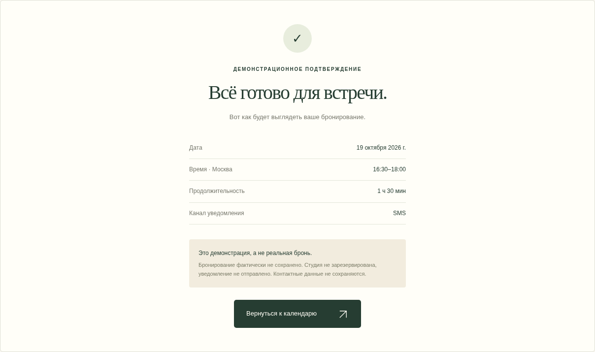
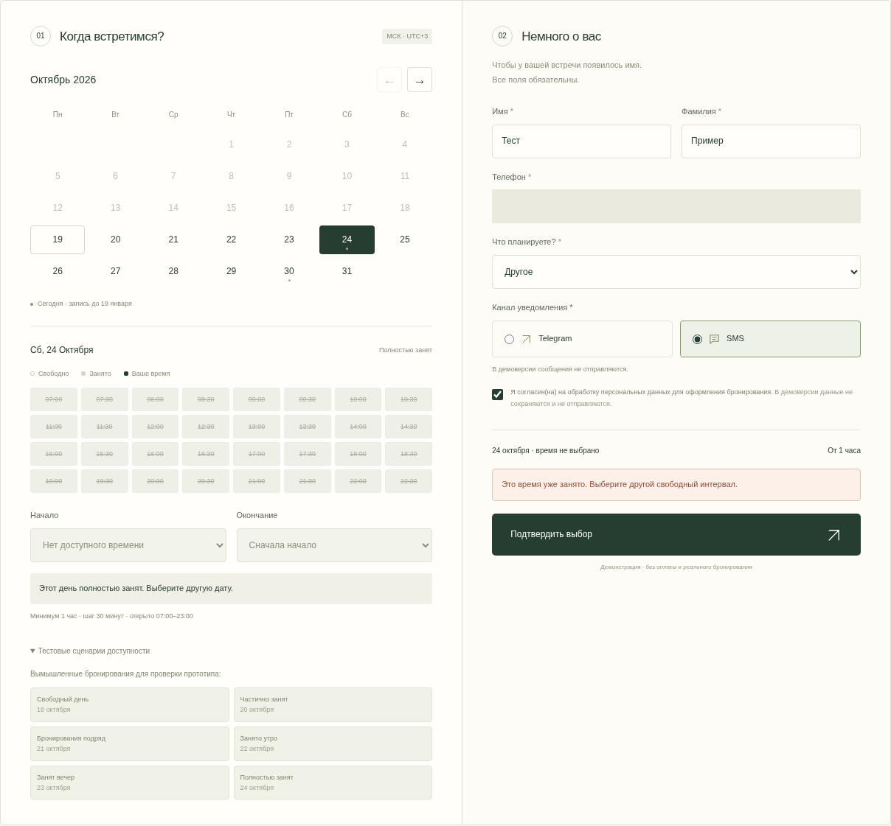

# Визуальная приёмка первого этапа

Дата: **18 октября 2026**, снимки созданы в **10:35 МСК**. Репозиторий: [jurist77/loft-booking](https://github.com/jurist77/loft-booking). Ветка первого этапа: `feat/frontend-mvp`.

Проверено существующее приложение в `/workspace/loft-booking`, без переписывания работающих модулей. Дополнены постоянные правила проекта, документация, сценарий браузерного конфликта и воспроизводимый сбор снимков. Серверная часть, БД, внешнее размещение и второй этап не разрабатывались.

## Семь скриншотов

Скриншоты сделаны Playwright в Chromium из работающего приложения. Поля формы заполнены вымышленными значениями «Тест Пример», номер взят из примеров ТЗ и скрыт на снимках формы.

| № | Экран | Файл |
|---|---|---|
| 1 | Главная целиком, компьютер 1440×1000 | [Открыть](acceptance/01-home-desktop.png) |
| 2 | Главная целиком, смартфон 390×844 | [Открыть](acceptance/02-home-mobile.png) |
| 3 | Календарь и все слоты частично занятого дня | [Открыть](acceptance/03-calendar-busy.png) |
| 4 | Выбор начала 16:30, автоматическое окончание 17:30 | [Открыть](acceptance/04-time-selection.png) |
| 5 | Форма бронирования с тестовыми данными | [Открыть](acceptance/05-booking-form.png) |
| 6 | Демонстрационное подтверждение 16:30–18:00 | [Открыть](acceptance/06-demo-confirmation.png) |
| 7 | Ошибка повторной проверки занятого интервала | [Открыть](acceptance/07-time-conflict.png) |

### Компьютер

### Смартфон

### Занятые слоты

### Начало и окончание

### Форма

### Подтверждение

### Конфликт

## Результаты контроля

- `npm test`: **62 пройдено, 0 ошибок**.
- `npm run test:e2e`: **8 пройдено, 0 ошибок, 0 пропусков**. Четыре сценария на каждом из двух размеров экрана.
- `npm run lint` и `npm run typecheck`: успешно.
- `npm run capture:acceptance`: семь снимков, ошибок клиентского JavaScript и консоли не обнаружено.
- В частично занятом дне видны **32** получасовых слота 07:00–22:30. **8** занятых слотов отключены и имеют CSS `line-through`.
- Занятые начала, полчаса перед занятой границей и 22:30 отсутствуют среди доступных начал.
- Выбор 16:30 автоматически устанавливает **17:30**. Допустимые окончания перед бронью с 18:00 — только **17:30 и 18:00**.
- Пересечения запрещены; соседние бронирования разрешены. Все пять форматов телефона из ТЗ нормализуются к `+79XXXXXXXXX`, то есть российскому мобильному номеру `+7` и десять цифр.
- На смартфоне отсутствует горизонтальное переполнение; полный сценарий, ошибки формы и конфликт проверены браузером.
- Машиночитаемые результаты снимков: [checks.json](acceptance/checks.json).

Конфликт получен штатным кодом приложения. Управляемые часы браузера переведены на сутки вперёд после выбора будущего свободного дня. Демонстрационные бронирования привязаны к текущему московскому дню, поэтому повторное чтение выявляет занятый интервал. Интерфейс показывает «Это время уже занято. Выберите другой свободный интервал.» и не подтверждает бронь. Рабочий код приложения не модифицировался для создания ошибки.

Встроенного интерактивного Preview в доступных инструментах текущей среды нет. Локальный сервер используется только для браузерных проверок; внутренний адрес не предоставляется как внешняя ссылка. Для этой приёмки используются скриншоты, внешний хостинг не подключался.

## Проверка состава коммита

Проверены исходники, тесты, конфигурация, lockfile, документация и иллюстрации. Секреты, токены, пароли, приватные ключи и реальные данные клиентов не обнаружены. В исходниках присутствуют только явно вымышленные контакты и номера из ТЗ для проверки нормализации. `.git`, `.env`, `node_modules`, `.next`, трассировки и временные файлы исключены из коммита. Снимки содержат тестовый интерфейс; телефон на заполненных формах скрыт.

## Обнаруженные проблемы и ограничения

Ошибок в проверенных сценариях бронирования не обнаружено. Сохраняются известные ограничения первого этапа:

1. Четыре изображения временные; настоящие фотографии ещё не предоставлены.
2. Адрес, правила аренды и текст подтверждения предварительные.
3. Бронирование не сохраняется, уведомления не отправляются — это предусмотрено ТЗ первого этапа.
4. ESLint 9.39.5 используется из-за совместимости плагинов Next.js; npm сообщает о завершении поддержки этой ветки. TypeScript 7 пока несовместим с текущим `typescript-eslint`, поэтому закреплён TypeScript 6.0.3. Без необходимости инструменты не заменялись.
5. Safari, Firefox и физические устройства отдельно не проверялись; выполнены проверки Chromium в настольном и мобильном режимах.

## Вопросы для согласования

- Утвердить внешний вид на компьютере и смартфоне, форму и текст ошибки.
- Предоставить четыре оригинальные фотографии и уточнить настоящий адрес и правила.
- Утвердить окончательный текст демонстрационного подтверждения.
- Подтвердить трактовку горизонта: сегодня → та же дата через три календарных месяца включительно, с переносом границы на конец короткого месяца.

Будущее размещение на собственном VPS Ubuntu 24.04 и бесплатный бюджет закреплены в `AGENTS.md`. На этом этапе сервер и внешние сервисы не подключаются. После приёмки ожидаются замечания заказчика; следующий этап требует отдельного разрешения.
