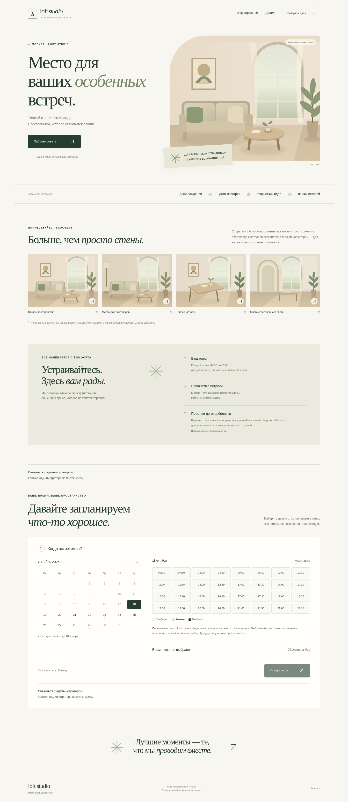
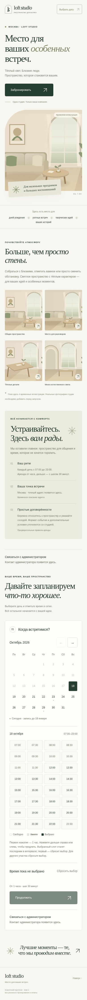
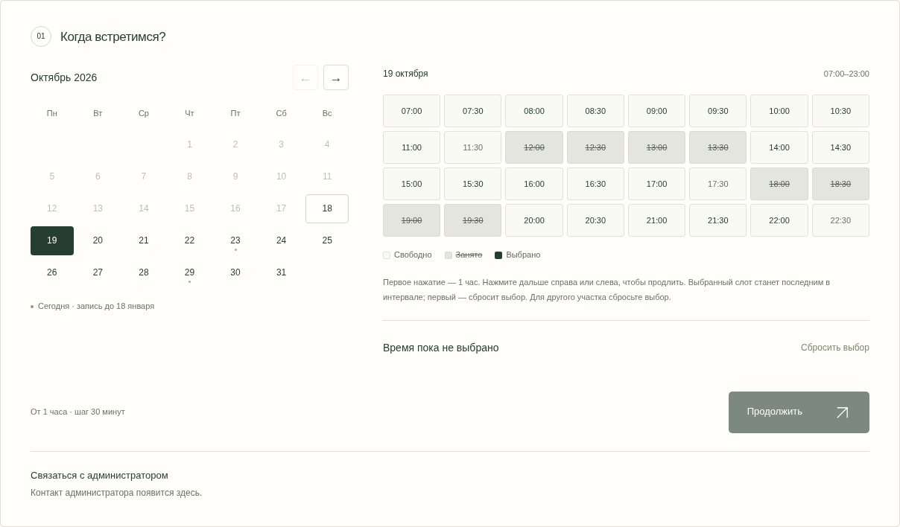
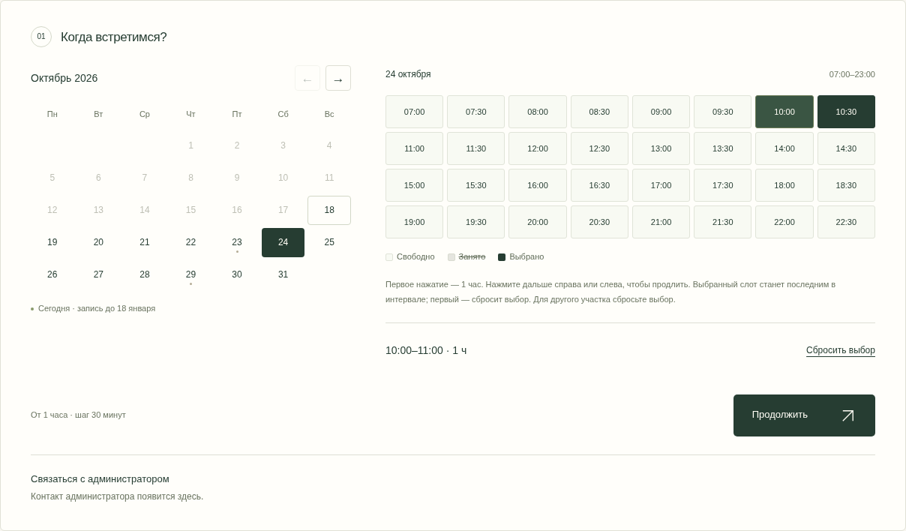
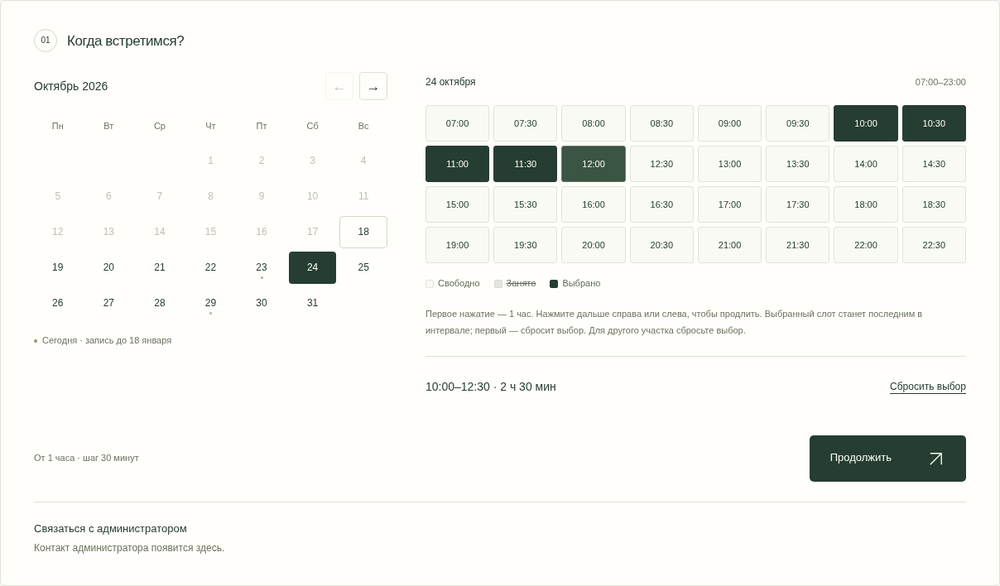
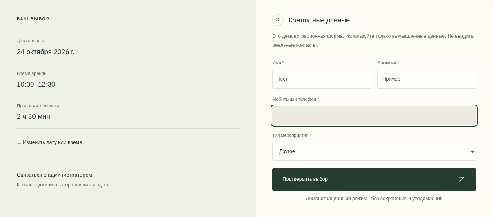
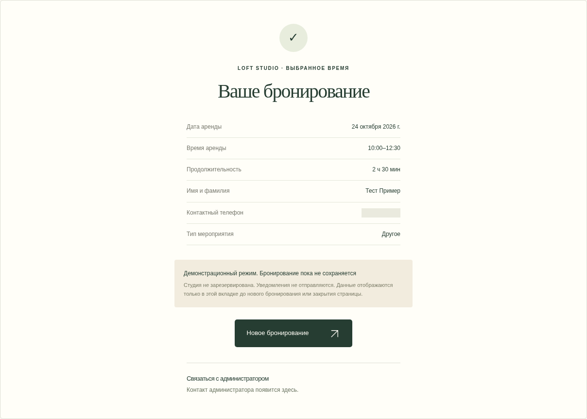

# Loft Booking — приёмка ТЗ №1.1

База: `b0b64010b97c72e3f0d62bd83f7aaef092da0d32` (`feat/frontend-mvp`). Рабочая ветка: [`feat/booking-ui-v1.1`](https://github.com/jurist77/loft-booking/tree/feat/booking-ui-v1.1). Проверки выполнены 18 октября 2026 года; снимки — **11:33 МСК**. Точное время и параметры браузера: [checks.json](checks.json).

## Что изменено

- В существующую архитектуру добавлена чистая функция непрерывного выбора интервала `src/lib/selection.ts`; московские расчёты и окно записи в `availability.ts` не менялись.
- Вместо выпадающих списков — вся сетка из 32 кнопок. Первое нажатие выбирает ровно час, дальнейшие нажатия расширяют интервал в обе стороны, включая промежуточные свободные слоты.
- Расширение через занятое время запрещено. Сокращение оставляет нажатый выбранный слот последним включённым, минимум — час. Первый выбранный слот сбрасывает всё; последний оставляет интервал без изменений. Есть явная кнопка сброса, смена даты очищает время.
- Под сеткой расположена трёхцветная легенда. Занятое время зачёркнуто, выбранное обозначено `aria-pressed`. Размер кнопок времени — не менее 44×44 px на проверенных экранах.
- Убраны указания часового пояса и переключатели тестовых сценариев. Сами вымышленные сценарии сохранены для тестов; их выбирают обычным календарём.
- Кнопка «Продолжить» открывает отдельный шаг контактных данных с выбранными датой, временем и продолжительностью. В форме четыре обязательных поля; согласие и Telegram/SMS скрыты. Код не добавляет скрытого согласия.
- «Ваше бронирование» показывает дату, время, длительность, имя, фамилию, нормализованный телефон и тип мероприятия. «Новое бронирование» очищает данные и возвращает к календарю.
- Контакт администратора доступен на главной и каждом шаге. `STUDIO.adminPhone = null`: номер не придуман, выводится заглушка. При заполнении настройки появляется `tel:`-ссылка, что проверено модульным тестом.
- Сохранены текущие четыре иллюстрации, Next.js, TypeScript, Tailwind, прежние тестовые файлы и правила `AGENTS.md`. Новых зависимостей, фотографий и внешних сервисов нет.

## Семь скриншотов

Изображения получены Playwright из финальной production-сборки, без ручной подстановки состояния в DOM. Контакты вымышленные («Тест Пример»); тестовый номер из ТЗ скрыт на изображениях формы и итога. Его отображение и нормализация отдельно проверены тестами.

| № | Состояние | Скриншот |
|---|---|---|
| 1 | Главная, компьютер 1440×1000 | [Открыть](01-home-desktop.png) |
| 2 | Главная, смартфон 390×844 | [Открыть](02-home-mobile.png) |
| 3 | Все 32 слота, 8 занятых | [Открыть](03-busy-grid.png) |
| 4 | Первое нажатие: 10:00–11:00, один час | [Открыть](04-one-hour.png) |
| 5 | Расширение: 10:00–12:30, 2 ч 30 мин | [Открыть](05-two-and-half-hours.png) |
| 6 | Отдельный шаг контактных данных | [Открыть](06-contact-form.png) |
| 7 | Итог «Ваше бронирование» | [Открыть](07-your-booking.png) |

## Обязательные команды

Node.js 24.19.0, npm 11.9.0, Chromium 154.0.8037.57. Зависимости и lockfile не менялись.

| Команда | Результат |
|---|---|
| `npm test` | **93 пройдено**, 5 файлов, 0 ошибок |
| `npm run test:e2e` | **14 пройдено**, 0 ошибок, 0 пропусков: 7 сценариев на компьютере и 7 на телефоне |
| `npm run typecheck` | Успешно |
| `npm run lint` | Успешно, без ошибок и предупреждений линтера |
| `npm run build` | Успешная production-сборка |
| `npm run capture:acceptance` | Семь снимков, проверка слотов, легенды и данных, 0 ошибок JavaScript/консоли |

Браузерные проверки повторно выполнены на итоговой production-сборке. Дополнительно пройдены главная, сетка, форма и итог на ширинах **320, 360, 390, 640, 700, 768, 1024, 1440 px**: горизонтального переполнения нет, кнопки времени не меньше 44×44 px.

## Покрытие 19 требований

| № | Требование | Автоматическая проверка |
|---|---|---|
| 1 | Все 32 слота | `availability.test.ts`, `grid.spec.ts`, сбор снимков |
| 2 | Занятые зачёркнуты и отключены | `booking.spec.ts`, `grid.spec.ts`, CSS-проверка при сборе снимков |
| 3 | Первый клик выбирает 60 минут | `selection.test.ts`, `grid.spec.ts`, `booking.spec.ts` |
| 4 | Расширение вправо | `selection.test.ts`, `grid.spec.ts` |
| 5 | Расширение влево | `selection.test.ts`, `grid.spec.ts` |
| 6 | Промежуточные слоты включаются | `selection.test.ts`, `grid.spec.ts`, пять выбранных кнопок на снимке |
| 7 | Нельзя пересечь занятую границу | `selection.test.ts`, `grid.spec.ts` |
| 8 | Сокращение сохраняет минимальный час | `selection.test.ts`, `grid.spec.ts` |
| 9 | Явный сброс и клик первого слота | `selection.test.ts`, `grid.spec.ts` |
| 10 | Смена даты сбрасывает время | `grid.spec.ts` |
| 11 | Окончание не позже 23:00 | `availability.test.ts`, `selection.test.ts`, `grid.spec.ts` |
| 12 | Нет пересечений, есть повторная проверка | `availability.test.ts`, `booking-service.test.ts`, `conflict.spec.ts` |
| 13 | Нет выпадающих списков времени | `grid.spec.ts`, сбор снимков |
| 14 | Легенда из трёх состояний | `grid.spec.ts`, сбор снимков |
| 15 | Нет переключателей тестовых сценариев | `grid.spec.ts`, выбор тестовых дат обычным календарём |
| 16 | Валидация/нормализация телефона | `validation.test.ts`, `booking.spec.ts`, `booking-service.test.ts` |
| 17 | Итог показывает правильные данные | `booking.spec.ts`, сбор снимков, `booking-service.test.ts` |
| 18 | Контакт администратора без номера | `admin-contact.test.ts`, `grid.spec.ts`, итог в `booking.spec.ts` |
| 19 | Компьютер и телефон | Все браузерные тесты в двух проектах и дополнительная проверка восьми ширин |

Сохранены и адаптированы все предыдущие модульные и браузерные тестовые файлы. Проверки московской смены даты, прошедших интервалов, соседних броней и границы трёх месяцев не удалялись. Конфликт в браузере воспроизводится управляемыми часами после выбора: новый снимок тестовых бронирований становится занятым, и штатная повторная проверка отклоняет подтверждение. Работа с клавиатурой проверена Enter/Space, состояние выбранных кнопок — `aria-pressed`, фокус — на форме и первом ошибочном поле.

## Как повторить

Из корня проекта запустить `npm ci`, затем `npm run build` и `npm start`. В другом терминале выполнить пять обязательных команд; сборку запускать отдельно от работающего dev-сервера. Для снимков при работающем приложении выполнить `npm run capture:acceptance` — файлы сохранятся в этой папке. `CHROMIUM_PATH` позволяет указать установленный Chromium на другой машине. В текущей среде системный браузер находится в `/usr/bin/chromium`.

Доступного встроенного интерактивного Preview в инструментах текущего чата нет. Внутренний адрес облачной машины не является внешней ссылкой. Публичный хостинг ради снимков не подключался.

## Ограничения и вопросы приёмки

- Адрес, маркетинговые тексты, окончательные оттенки и четыре оригинальные фотографии остаются на согласование. Прежние иллюстрации сохранены без изменений.
- Номер администратора пока не предоставлен; настройка пуста и настоящего звонка из интерфейса пока нет.
- Данные полностью вымышленные. Подтверждение не резервирует студию и не сохраняет бронь. Уведомления не отправляются.
- Демонстрационный итог удерживает введённые тестовые контакты в памяти вкладки до нового бронирования, перезагрузки или закрытия. Сетевой отправки и записи в браузерное хранилище нет.
- Удаление чекбокса согласия не является юридическим решением для production. Перед реальной обработкой персональных данных нужно определить правовое основание, обязательные уведомления и требования законодательства; при необходимости добавить текст или отдельное согласие.
- Telegram/SMS сохранены как необязательные типы/предпочтения в архитектуре, но не показываются как клиентский выбор и не реализованы.
- Все браузерные проверки выполнены в Chromium. Физические телефоны, Safari и Firefox отдельно не проверялись; приоритет следующей визуальной приёмки — телефон заказчика.
- Сохраняется прежняя совместимость инструментов: TypeScript 6.0.3 и ESLint 9.39.5. Обновление ветки ESLint, снятой с поддержки, требует совместимых версий плагинов; зависимости в этом этапе не менялись.

Ошибок в проверенных сценариях не обнаружено. БД, административная панель, серверная инфраструктура, сохранение, платные API, сообщения, платежи и внешнее развёртывание не добавлялись. `AGENTS.md` сохранён. Второй этап не начат, слияние веток не выполняется. После отправки результата ожидается визуальная приёмка заказчиком.
