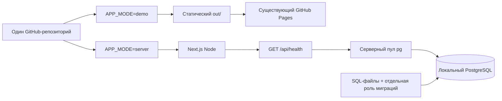

# studio 19.25 · backend foundation 2.1

## Утверждённый стек и границы этапа

Одно приложение Next.js/TypeScript: клиентский интерфейс и будущий REST API через Route Handlers. База — PostgreSQL, драйвер — `pg`, миграции — SQL-файлы. Локальная БД запускается официальным `postgres:17-alpine` через Docker Compose. Существующие Vitest/Playwright и GitHub Actions сохранены. Prisma, внешних SaaS/БД и платных компонентов нет. Целевая площадка — собственный Ubuntu 24.04 VPS; развёртывание сейчас не выполняется.

В 2.1 реализованы только конфигурация, соединения, роли, миграционный журнал и `GET /api/health`. Таблицы бронирований/событий, операции записи/чтения/отмены, настоящая занятость, клиентская авторизация, администратор, оплата и уведомления отсутствуют.

## DEMO и SERVER

Режим задаётся **явно** `APP_MODE=demo|server`; наличие `DATABASE_URL` ничего не переключает. Неподдерживаемый режим отклоняется. Публичный `NEXT_PUBLIC_APP_MODE` выводится из этого значения конфигурацией Next.js и содержит только имя режима. `NODE_ENV=production` описывает оптимизацию Node-сборки и не заменяет `APP_MODE`.

Команды `dev/build/start` принудительно выбирают DEMO Node; `build:demo` — статический DEMO; `dev:server/build:server/start:server` — SERVER Node. `.env.local` с серверными настройками не может случайно переключить команды DEMO. Каталоги `.next` и `.next-server` разделены; экспорт Pages остаётся `out/`.

В DEMO полностью сохранены пять экранов, бренд/логотип/изображения, вымышленные интервалы и предупреждения. Контакты не отправляются и не сохраняются. Приложение работает без БД; адрес Pages не меняется: https://jurist77.github.io/loft-booking/.

В SERVER на текущем этапе показывается прежний Welcome с сообщением «Серверный режим · Онлайн-запись пока недоступна» и отключённым началом записи. Демонстрационная занятость не выдаётся за реальные данные. Реальную клиентскую запись подключит отдельный этап через существующую границу `BookingService`. Дизайн и путь DEMO не изменены.

Серверный маршрут имеет имя `src/app/api/health/route.server.ts`. Поддерживаемая настройка Next.js `pageExtensions` включает `server.ts` только в SERVER. Поэтому в DEMO маршрут вообще не регистрируется и не экспортируется; не нужны фиктивный backend, временное удаление файлов или обращение к БД при build. В SERVER это настоящий динамический Node Route Handler, не кешированный статический ответ.

## Компоненты и секреты

- `src/lib/app-mode.ts` — несекретный выбор режима.
- `src/server/config.ts` — проверка приватных переменных и пределов тайм-аутов.
- `src/server/database.ts` — ленивый пул `pg`, повторно используемый процессом Next.js, и явное закрытие для тестов/скриптов.
- `src/server/health.ts` — только `SELECT 1` и минимальный ответ состояния.
- `src/server/migrations.ts`, `migrations/` — контроль и выполнение SQL.
- `compose.yaml`, `docker/postgres/init-roles.sh` — локальный PostgreSQL и начальные роли.

Серверные модули помечены `server-only`: Next.js отклонит их импорт клиентским компонентом. React-компоненты не выполняют SQL. Vitest заменяет только этот маркер границы Next.js, чтобы запускать серверный код в Node; настоящий `pg`, соединения и SQL в интеграционных тестах не подменяются.

`DATABASE_URL`, `MIGRATION_DATABASE_URL` и пароли остаются серверными. Нельзя помещать их в `NEXT_PUBLIC_*`, `next.config.env`, props, URL интерфейса, логи или Git. `.env.local` и `.env.test.local` игнорируются Git; `.env.example` содержит только несекретные имена/пустые значения. `db:env` создаёт локальные случайные учётные данные с правами файла 0600, не выводит их и не перезаписывает существующие файлы. Это не production-секреты.

Пул приложения по умолчанию: до 5 соединений, подключение до 2 секунд, запрос/statement до 2 секунд, idle 10 секунд, lock timeout до 1 секунды. Значения ограничены конфигурацией; миграции имеют отдельный лимит запроса 30 секунд и одно соединение. Ослабляющие проверку TLS режимы URL `no-verify/prefer/allow` отклоняются. Для локального loopback Compose используется `sslmode=disable`; будущий удалённый PostgreSQL требует отдельно настроенного доверенного TLS, а не отключения проверки сертификатов.

## Роли и локальные окружения

Разработка и интеграционные тесты используют разные Compose projects, базы, роли, пароли, порты и именованные volumes. Порты по умолчанию — **127.0.0.1:54329** и **127.0.0.1:54330**, внешних привязок нет. Healthcheck выполняет аутентифицированный `SELECT 1` именно ролью приложения и не считает один запущенный процесс признаком готовности.

Официальный образ создаёт bootstrap-владельца PostgreSQL для первоначального init. Он используется только для создания базы/ролей и не передаётся приложению или миграционному CLI. Новых административных аккаунтов самого приложения нет.

Роль приложения — LOGIN, NOSUPERUSER, NOCREATEDB, NOCREATEROLE, NOREPLICATION, NOBYPASSRLS; только CONNECT к своей БД и USAGE схемы `studio`. Она не может создавать таблицы или читать/изменять журнал миграций. Отдельная роль миграций также не superuser, но владеет схемой `studio`. PUBLIC лишён прав на БД/схему public. Широких автоматических прав на будущие таблицы нет: нужные гранты будут добавляться явно миграциями этапа 2.2.

Volume сохраняется после `stop`, перезапуска и штатного удаления контейнера без volume. Стандартная остановка **не использует `down -v`**. Init-скрипт выполняется только на новом volume; смена пароля в файле не меняет пароль существующей роли автоматически.

## Миграции и целостность

Файлы UTF-8/LF: `0001_foundation.sql`, затем `0002_*.sql` и далее, без пропусков и повторов версий. Записанные в историю файлы нельзя менять, переименовывать или удалять. История хранится в `studio.schema_migrations`: версия, имя файла, SHA-256 и время применения.

На одном выделенном соединении берётся session advisory lock. Другой процесс получает безопасный код `MIGRATION_LOCKED` и ненулевой exit code. Под lock проверяется полный применённый префикс файлов; расхождения версии/имени/хэша и исчезнувшие применённые файлы приводят к `HISTORY_MISMATCH` до выполнения нового SQL. Оставшийся пакет применяется последовательно одной транзакцией вместе с записями журнала. Повторный запуск возвращает ноль новых миграций. При SQL-ошибке текущая неприменённая транзакция откатывается, ранее зафиксированные данные не удаляются; автоматических down-миграций нет. Lock освобождается в `finally`; повреждённое соединение уничтожается.

SQL — доверенный код, проходящий review. Файлы не должны содержать собственные BEGIN/COMMIT/ROLLBACK либо операции, запрещённые внутри транзакции. Это не sandbox для непроверенного SQL. Журнал защищён от приложения, но владелец миграционной роли технически способен его изменить; его доступ требует отдельного контроля. Первая миграция задаёт только комментарий схемы. Кроме служебного журнала таблиц нет.

## Health endpoint

`GET /api/health` доступен только в SERVER и выполняет запрос через роль приложения:

- БД доступна: HTTP 200, `{"status":"ok"}`.
- БД недоступна или конфигурация подключения непригодна: HTTP 503, `{"status":"unavailable"}`.
- Заголовок `Cache-Control: no-store`; в ответе нет хоста, версии PostgreSQL, имени базы/ролей, пути, SQL, паролей и персональных данных.

Это проверка доступности процесса и соединения, а не готовности будущих бизнес-таблиц и не диагностическая панель. Обработчиков записи/чтения броней нет. Node-команды по умолчанию слушают 127.0.0.1. На будущем VPS health рекомендуется оставить внутренней проверкой reverse proxy/мониторинга; правила публичного доступа согласуются отдельно.

## Зафиксированные продуктовые правила для следующих этапов

1. Одна студия — studio 19.25.
2. Рабочие часы 09:00–23:00.
3. Часовой пояс Europe/Moscow.
4. Шаг 30 минут.
5. Минимум 60 минут.
6. Максимум ограничен одним рабочим днём, до 14 часов; выход за его границы запрещён.
7. Буфера между бронями нет.
8. Соседние `[start,end)` интервалы разрешены.
9. Реальное бронирование автоматически подтверждается после успешной записи в БД.
10. Лимита количества броней на один телефон пока нет.
11. Повтор того же запроса должен быть идемпотентен; самостоятельное новое бронирование разрешено.
12. Клиент не изменяет/отменяет бронь самостоятельно.
13. Отменённые брони сохраняются в истории, освобождая интервал.
14. Окно — московская текущая дата +3 календарных месяца включительно с прежним clamp короткого месяца.
15. Контакты — имя, фамилия, российский мобильный телефон.
16. Оплаты на этом этапе нет.

Эти правила **не реализованы как серверные операции в 2.1**. Действующие клиентские правила времени сохранены.

## Будущая БД — проектное направление, не созданная схема

Этапу 2.2 предстоит отдельно реализовать `bookings` (идентификатор, начало/окончание timestamptz, статус confirmed/cancelled, три контактных поля, timestamps), `booking_events` для истории и идемпотентность (ключ запроса, отпечаток payload и результат). Новый ключ означает самостоятельную операцию; повтор ключа с тем же payload возвращает тот же результат, с другим payload отклоняется. Нельзя превращать телефон в уникальный ключ брони.

Защиту пересечений нужно обеспечить атомарно на сервере и PostgreSQL для активных `[start,end)` интервалов; отменённые записи остаются в истории и не блокируют время. Окончательные DDL, ограничения, контракт API, сроки хранения персональных данных и необходимые правовые тексты согласуются в следующем этапе. В 2.1 нет этих таблиц, индексов, ограничений, endpoints и реальных контактных данных.

## CI и перенос на VPS

Существующий Pages workflow оставлен без изменений и не запускает PostgreSQL. Отдельный `backend-checks.yml` собирает SERVER, поднимает только собственную локальную тестовую БД, выполняет реальные интеграционные/HTTP-проверки и доказывает независимость static export. Production-базы, VPS или платного сервиса CI не требует. Проверка отказа БД останавливает только тестовый Compose project.

На Ubuntu 24.04 можно сохранить тот же Node target, Route Handlers, `pg` и SQL-миграции. В будущем потребуются reverse proxy/HTTPS, защищённые серверные секреты, резервные копии с проверкой восстановления, ограниченная сеть БД, миграции перед релизом, мониторинг и откат версии приложения. Локальный env объединяет параметры ради воспроизводимого Compose; в production процессу Next.js следует выдавать только роль приложения, а bootstrap/миграционные секреты — отдельному процессу подготовки/релиза. Сейчас это документация: VPS, VPN и другие проекты не перенастраивались.

Инструкция для запуска: [backend-local-setup.md](backend-local-setup.md). Фактические результаты проверки этой ветки: [backend-acceptance-v2.1.md](backend-acceptance-v2.1.md).
