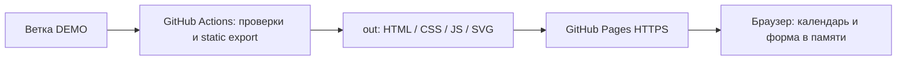
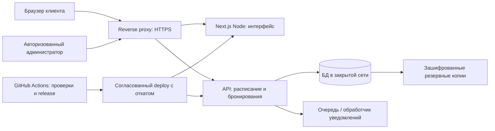

# Архитектура DEMO и будущего VPS

## Обновление в этапе 2.1

Утверждены Next.js Route Handlers, PostgreSQL и драйвер `pg`. Подготовлены локальный Docker Compose, разделение DEMO/SERVER, журнал SQL-миграций и health endpoint. Бизнес-операции и таблицы бронирований не реализованы; VPS не развёрнут. Актуальная архитектура — [backend-architecture.md](backend-architecture.md), воспроизводимый запуск — [backend-local-setup.md](backend-local-setup.md). Ниже сохранён контекст анализа этапа 1.2; прежние формулировки о невыбранной БД относятся к этому историческому этапу.

## Состояние на этапе 1.2

Next.js 16.4.2 App Router, React 19.3.1, TypeScript 6.0.3, Tailwind CSS 4.3.3; npm/Node.js 24. Проверки — Vitest 5 и Playwright. ESLint 9.39.5 сохранён из исходного этапа из-за совместимости плагинов; обновление требует отдельной проверки. Источник зависимостей — `package-lock.json`, установка `npm ci`.

Одна страница и клиентские шаги в памяти. `BookingService` — существующая граница доступности/подтверждения; текущая реализация использует вымышленные интервалы. API, БД, авторизации и реального сохранения нет. Контакт администратора пока пустой. Четыре локальные SVG-иллюстрации сохранены.

## DEMO

Статический экспорт задаётся только `DEPLOY_TARGET=pages`. Изображения не требуют оптимизатора Next.js. Ресурсы учитывают конфигурационный basePath. Дата и тестовая занятость вычисляются после открытия браузера: статическая публикация не замораживает календарь на дате build. Серверное request-time вычисление исходной версии заменено клиентской инициализацией без изменения правил дат/интервалов.

Для DEMO подходит бесплатный публичный репозиторий. Это временный прототип, а не действующий сервис записи. Успешный локальный экспорт не доказывает успешный deployment; отдельное задание проверяет реальный HTTPS-адрес. Подробности — [инструкция DEMO](demo-deployment.md).

## Предлагаемая схема Ubuntu 24.04 VPS — только анализ

Рассмотреть Nginx или Caddy и бесплатный HTTPS Let's Encrypt, Node.js под systemd либо контейнеры. Порты БД наружу не открывать; действующий VPN и другие проекты не перенастраивать. Изоляция тестового и рабочего окружений: разные конфигурации, базы/учётные записи, домены и секреты. Публичные `NEXT_PUBLIC_*` — только несекретные настройки; пароли БД/ключи уведомлений остаются на сервере.

Перед выбором API сравнить Next.js Route Handlers (меньше отдельных процессов, общий TypeScript) и отдельный сервис, например Fastify или Python (независимый жизненный цикл, больше эксплуатации и контрактов). Статический Pages backend не поддерживает ни один вариант; обычная Node-сборка Next.js сохранена и проверена. Окончательный выбор не сделан.

Перед выбором БД сравнить PostgreSQL (транзакции и ограничения пересечения диапазонов), MySQL/MariaDB (транзакционная сериализация/блокировки для интервалов) и SQLite (простота эксплуатации, ограничения конкурентной записи и масштабирования). Нельзя обеспечить защиту от двойной брони одним клиентским запросом «свободно ли»: проверка и создание должны быть атомарны на сервере/в транзакции. Окончательная СУБД требует согласования после оценки нагрузки и администрирования.

Уведомления потребуют отдельной очереди/повторов и идемпотентности. Telegram можно оценить как бесплатный канал при наличии согласованного бота; SMS обычно тарифицируются и не являются обязательной бесплатной зависимостью. Ничего из этого сейчас не подключается. Для бэкапов выбрать доступное собственное место хранения и проверять восстановление; наличие файла копии не равно работоспособному восстановлению.

## Переносимость

Без изменения согласованного поведения можно перенести компоненты галереи, календаря, сетки, формы и итогового экрана, стили, изображения, доступность, типы контактов/интервалов, чистые функции выбора и московских дат. `STUDIO` сохраняет единую конфигурацию; UI не содержит адрес GitHub Pages.

Добавить/адаптировать позже: реализацию `BookingService` через согласованный API; загрузку настоящего расписания; серверную валидацию и атомарное создание; обработку ошибок сети/повторов; различие реального и DEMO-подтверждения; административную авторизацию/роли; управление расписанием; миграции БД; уведомления; мониторинг, бэкапы, релизы и откат. Сервер обязан повторять проверки дат, длительности и доступности, доверять браузеру нельзя. Граница интервалов `[start,end)` и `Europe/Moscow` должна оставаться общей договорённостью API и UI.

Прежний запланированный переключатель `production` (в 2.1 заменён явным `APP_MODE=server`) в конфигурации сам по себе не реализует backend и не превращает текущую DEMO-форму в работающую запись. Изменение public-параметров требует пересборки Next.js. Серверные секреты не должны попадать в клиентский bundle.

## Риски и следующий согласуемый этап

- Гонки бронирований: нужны транзакционные гарантии и тест двух одновременных запросов, а не только повторная клиентская проверка.
- Часы браузера могут быть неверны: рабочая версия должна получать авторитетные ограничения с сервера, сохранив отображение московских дат.
- Персональные данные: согласовать правовое основание, обязательные тексты/согласия, сроки хранения, доступ администратора, защиту журналов и резервных копий до обработки реальных контактов.
- Pages не поддерживает API и имеет ограничения коммерческого использования; переносить реальную запись на VPS до её включения.
- Автоматизация GitHub зависит от прав аккаунта, видимости репозитория и защиты окружения; готовый YAML не является доказательством публикации.
- Safari/iOS и физические устройства требуют ручной приёмки. Автотесты в этом этапе — Chromium, в том числе мобильная эмуляция.
- Следить за совместимостью/поддержкой ESLint и библиотек; текущий этап не меняет зависимости без необходимости.

Рекомендация: сначала принять публичный DEMO на телефоне и Mac, затем отдельно согласовать API/модель данных, атомарную защиту бронирования, администраторские роли, обработку персональных данных и план эксплуатации VPS. Backend, БД, VPN, серверы, уведомления и следующий функциональный этап в ТЗ №1.2 не реализованы.
