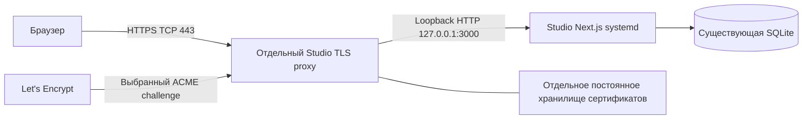

# Studio 19.25 — первый этап HTTPS: read-only аудит и проект

Этот PR не настраивает TLS, не подключается к VPS и не запускает диагностику.
После согласованного merge владелец отдельно запускает аудит. Только его реальные
результаты позволяют выбрать архитектуру. Следующий PR с установкой требует
отдельного согласования; здесь нет install/apply, расписания или открытия портов.

## Как получить факты

Actions → **Diagnose Studio HTTPS readiness** → Run workflow → **main** →
**server_ip**: голый IPv4/IPv6 нужного VPS, без URL, порта, скобок или zone-id.
Единственный Secret — существующий `STUDIO_SSH_PASSWORD`. SSH — root:22 через
общий helper Studio. Новый токен/пароль/known_hosts для аудита не нужен.

Результат находится в Summary запуска. Зелёный job означает получение отчёта,
а не готовность HTTPS. При SSH/auth/protocol error — ненулевой exit и безопасный
код. Исходный вывод команд не печатается и не загружается в artifacts. Для анализа
передавать только Summary; не пересылать env, журналы, дампы правил или ключи.

IP читается из стандартного GitHub event JSON, проверяется и маскируется перед
дальнейшими шагами; не подставляется в shell-команду и не включается в Summary.
GitHub всё равно хранит введённый workflow input в метаданных запуска. Не вводить
вместо IP чувствительные строки. Чужие адреса, DNS-имена, PID/fd/inode, пути
релизов и произвольные имена процессов в отчёт не попадают. Процессы показываются
только категориями из allowlist (например nginx/caddy/xray/other).

Согласованная SSH-политика: `-F /dev/null`, host-key check отключён только для
Studio-команд, known-hosts `/dev/null`, root-пароль только через окружение sshpass.
**Риск MITM остаётся: подставной сервер может получить root-пароль и подделать
наблюдения.** Фильтрация JSON не заменяет аутентификацию сервера. Глобальная
SSH-конфигурация VPS и других workflows не меняется.

### Что проверяет workflow

| Область | Факты / ограничения |
| --- | --- |
| Платформа | Ubuntu 24.04, x64/ARM64, root; read-only `adjtimex --print` проверяет kernel STA_UNSYNC. Нет инструмента — unknown, без установки. Это признак состояния часов, не измерение точности UTC; без D-Bus активации timedated. OS metadata без hostname |
| Studio systemd | Только выбранные properties: состояние, отдельный User, managed RootDirectory/WorkingDirectory, private network/namespace и наличие drop-ins. Не читаются Environment, ExecStart, journal или unit/config contents |
| Права | lstat известных Studio путей: config dir 0700/root, env 0600/root, data dir 0700/UID пользователя studio1925, unit root и без group/world write. UID/GID приложения должны быть не нулевыми. Без чтения SQLite или env |
| Studio TCP/3000 | Существующие kernel ss inode/cookie/fd helpers: принадлежность каждого сокета MainPID с проверкой `/proc/<MainPID>/fd/<fd>`, повторный снимок service/сокетов; иной процесс/смена сокета не считается доказанной Studio |
| TCP/80,443 | Отдельно IPv4/IPv6: занят/нет наблюдаемого listener, тип bind, безопасная категория процесса, per-socket v6only при наличии. Любой listener, включая loopback/неизвестный процесс, исключает автоматическое занятие порта |
| Локальный health | Один GET `127.0.0.1:3000/api/health`, код и точный ожидаемый ответ. Тело/заголовки не публикуются. Endpoint выполняет собственную штатную проверку SQLite; аудит не открывает БД и не вызывает availability/POST/bookings |
| DNS/proxy/ACME | Состояние известных service/timer names, наличие известных команд и metadata только фиксированных каталогов `/etc/letsencrypt`, `/var/lib/caddy`, `/root/.acme.sh`. Не читаются их содержимое, DNS/VPN/ACME конфиги, crontab, ключи и token-файлы |
| Firewall | Read-only UFW status verbose, nft JSON ruleset, полные iptables/ip6tables-save и legacy-save включая NAT. Только policies/counts/признаки jumps, sets, NAT, других hooks и missing/error; без raw rules, chain names, адресов, комментариев |
| Внешняя сеть | С disposable runner: по одной TCP-попытке 80/443; если 443 открыт — один TLS handshake с обычной CA/IP verification. Нет HTTP-запросов к чужому web-приложению, перебора SNI, редиректов или отключения проверки сертификата |
| Срок сертификата | Только для сертификата, успешно проверенного именно для введённого IP: корзина остаточного срока, без subject/SAN/issuer. Доменные сертификаты по голому IP могут не пройти проверку — это не доказательство неисправности HTTPS по hostname |

Известные unit names: nginx/caddy/apache2/haproxy/traefik, certbot и его timer,
snap.certbot.renew, acme-sh, systemd-resolved/named/unbound/dnsmasq/ddclient,
duckdns.timer. `not_observed` не означает, что механизма нет: custom services,
контейнеры, скрипты и cron без чтения их конфигурации полностью не инвентаризируются.
Поле `custom_configuration=not_inspected` всегда явно показывает этот предел.

Команды ограничены allowlist, 2 MiB stdout и 5 секунд на команду; HTTP — 512 байт
и 5 секунд, external TCP — 4 секунды/порт, TLS — 5 секунд. SSH deadline 150 секунд,
workflow — 5 минут. Отсутствующие инструменты не устанавливаются на VPS. sshpass
при необходимости устанавливается только на GitHub runner. Probe передаётся через
TemporaryFile с настоящим fileno на runner, на VPS — `python3 -I -B -S -`, без
записи скрипта, Python bytecode, installer state или lock. Завершаются только
собственные зависшие процессы чтения; чужие службы не затрагиваются.

SSH, TCP/TLS и GET могут обновить штатные журналы/счётчики доступа существующих
служб. «Read-only» здесь означает отсутствие изменения конфигурации, данных
бронирований, DNS, сертификатов, правил или состояния служб; не отсутствие сетевых
пакетов/учёта подключений. Нагрузочного теста VPN нет.

### Как понимать verdict

| Код | Дальнейшее решение |
| --- | --- |
| `INCONCLUSIVE` | Неполные ss/clock/service inventory или нестандартные drop-ins: сначала выяснить недостающие факты |
| `STUDIO_PREFLIGHT_FAILED` | Платформа, права, Studio identity/health/изоляция не подтверждены: остановить проект установки до отдельного разбора |
| `EXISTING_443_LISTENER` | Не захватывать 443, не останавливать владельца; нужна другая одобренная схема/другой уже имеющийся VPS |
| `PORT_80_CHALLENGE_REVIEW` | Не использовать standalone ACME с остановкой чужого 80; рассмотреть TLS-ALPN-01 или DNS-01 при свободном 443 |
| `NETWORK_PATH_REVIEW_REQUIRED` | Дополнительные/неизвестные правила, default deny, NAT/jumps/legacy либо внешний открытый порт при отсутствии listener: путь пакетов не доказан |
| `FREE_PORTS_OBSERVED_REVIEW_REQUIRED` | На снимке порты свободны; это кандидат, требующий DNS, проверки сети/ресурсов/VPN и разрешения владельца, а не READY_TO_APPLY |

Сводка не является полным firewall evaluator: порядок, sets/ranges, negations,
несколько hooks/backend layers, маршрутизация/фильтрация провайдера и NAT требуют
отдельного рассмотрения. Даже прямой ALLOW не доказывает достижимость. Любые
неизвестные правила не разрешают будущий apply. Не предлагается «исправлять» чужие
цепочки. Один runner не проверяет все сети; снимки не атомарны, порт может заняться
позже. В будущем install обязан повторить preflight непосредственно перед bind.
Внешние соединения проверяют только введённый IP и его семейство, не все адреса
VPS/hostname. Отсутствие ответа из runner не различает firewall, NAT, провайдера
и egress runner. Проверка обоих A/AAAA/семейств после выбора hostname обязательна.
Проверка прав ограничена перечисленными mode/UID/GID metadata и не заменяет
installer integrity checks, аудит ACL/supplementary groups или оценку доступа
других локальных пользователей. Конфигурации ради этого не раскрываются.

## Реестр фактов до запуска

| Вопрос | Состояние сейчас |
| --- | --- |
| Studio доступна по HTTP:3000 | Сообщено владельцем; новым аудитом не проверялось |
| TCP/80 и 443, владелец, IPv4/IPv6 | Не измерены этим PR |
| Существующие proxy, DNS/ACME, TLS | Не измерены; custom configuration может потребовать отдельного обезличенного подтверждения владельца |
| UFW, nft/iptables/legacy, внешний путь | Не измерены; прежние наблюдения нельзя считать текущей гарантией |
| Точный свободный DuckDNS hostname, A/AAAA/CAA | Владелец ещё не выбрал/не подтвердил; по одному server_ip определить нельзя |
| API Origin и installer compatibility | По коду main обнаружена необходимость согласованной поддержки HTTPS в следующем этапе |
| Окончательная возможность совместного размещения | Не установлена без фактического Summary и подтверждения VPN baseline/ресурсов |

## Варианты бесплатного HTTPS

| Вариант | Требования | Вывод |
| --- | --- | --- |
| **DuckDNS hostname + Let's Encrypt + отдельный Caddy Studio** | Владелец контролирует свободный `<hostname>.duckdns.org`, верные A/AAAA; TCP/443 свободен; HTTP-01 требует свободного и достижимого 80, либо проверенный TLS-ALPN-01 на 443 | Предпочтительный кандидат: тот же URL сохраняется при переезде, встроенное автопродление без отдельного постоянно работающего ACME daemon |
| DuckDNS + DNS-01 | Автоматический TXT через DuckDNS API; свободный HTTPS listener всё равно нужен, token защищён; DNS provider module требует отдельной воспроизводимой сборки/проверки | Альтернатива занятому/закрытому 80. Не позволяет делить занятый 443 и не входит в этот PR |
| IP certificate Let's Encrypt | Публичный стабильный IPv4/IPv6, shortlived profile, ACME client с поддержкой IP, HTTP-01 на 80 или TLS-ALPN-01 на 443; надёжное частое продление | Реальный бесплатный вариант, но хуже переносится: сменился IP — новый сертификат и Origin. DNS-01 для IP невозможен |
| Чужой proxy/VPN уже на 443 | Изменение чужой конфигурации/SNI/ALPN multiplexing | В рамках этой задачи запрещено. Не реализовывать port sharing, перехват listener или остановку VPN |

DuckDNS предоставляет бесплатный hostname и A/AAAA/TXT; перед внедрением владелец
подтверждает доступность имени/аккаунта и текущие условия. При постоянном IP не
нужен постоянно работающий DDNS updater: запись может быть установлена владельцем
в кабинете, а при переносе изменена отдельно. Не устанавливать AAAA до проверки
сквозного IPv6. Старый/ошибочный AAAA может ломать ACME и доступ части клиентов.
Не менять DNS сервера/маршрутизацию VPS. TXT automation не нужна для HTTP-01;
токен DuckDNS не добавляется в текущий аудит. Для DNS-01 — только закрытое хранилище
следующего этапа, без токена в URL логов, argv, git или клиенте; учитывать широкий
доступ токена аккаунта и конкуренцию TXT-обновлений.

### IP certificates: актуальные ограничения

По официальной публикации Let's Encrypt от 15.01.2026 общедоступны IPv4/IPv6
сертификаты с обязательным профилем `shortlived`: **160 часов**, не 90 дней.
Публикация от 11.03.2026 описывает Certbot `--ip-address` с 5.3 и webroot с **5.4+**.
Для этого варианта проверять поддерживаемый клиент/профиль, ACME staging и фактический
notAfter; системный пакет Ubuntu 24.04 может быть старее и не считается совместимым
без проверки. Нельзя обещать поддержку IP-профиля произвольной версией Caddy.
Если выбран Certbot: только certonly/webroot у собственного proxy, безопасный deploy
hook с config test и reload исключительно Studio proxy. Не использовать standalone,
если для него требуется остановить существующий listener. Staging chain не считается
готовым HTTPS и не заменяет рабочий сертификат.

Срок обычных сертификатов тоже сокращается: опубликован переход default на 64 дня
с 10.02.2027. Продление привязывать к фактическому сроку/ARI, а не жёстким «раз в 90
дней». У выбранного клиента подтвердить ARI/профили на staging в следующем PR.

## Предлагаемая архитектура после одобрения

Одна отдельная `studio1925-tls.service`, отдельный непривилегированный пользователь
и каталоги конфигурации/сертификатов/состояния, без доступа к SQLite/VPN. Конфиг
root:TLS-group 0640 в каталоге 0750, изменяет только root; private state — TLS-user,
каталог 0700 и ключи 0600. Runtime user читает только собственное TLS state; у приложения доступа
к приватным TLS-ключам нет. Proxy имеет только необходимый CAP_NET_BIND_SERVICE,
не root; restart-on-failure, bounded logs и разумные лимиты после измерений.
У Next сохраняются его текущие sandbox, WAL/FULL synchronous и постоянные данные.
Нет unit dependencies, PartOf/BindsTo/ExecStartPre, управляющих VPN или чужими proxy.

Предпочтительный proxy — проверенный Caddy binary отдельной закреплённой версии с
явным issuer Let's Encrypt, без автоматического перехода на иной CA. Проверять
официальную целостность, лицензию, x64/ARM64/Ubuntu совместимость; не выполнять сборку
на VPS. Не устанавливать distro-пакет, автоматически запускающий глобальный web
server. Не использовать существующие caddy/nginx конфиги, service unit и хранилища.
**HTTP/3 отключить**: только TCP h1/h2, без нового UDP/443 listener и влияния на UDP VPN.
Admin API proxy — только Unix socket внутри private RuntimeDirectory 0700, без
TCP/2019 или публичной панели. Поддержку Unix socket/безопасного reload подтвердить
для выбранного binary; штатное продление внутри proxy не требует перезапуска Next.
ACME на 80/443 используется только при отдельно одобренном владении этими портами.

## Будущий install / cutover

1. Получить реальный audit Summary. Подтвердить владельца всех listeners, NAT/
   firewall path и baseline VPN/другого приложения. Устранение неоднозначности —
   отдельный review, не автоматическое изменение чужой сети. Выбрать hostname,
   проверить A/AAAA/CAA извне. Утвердить окно работ, ресурсный запас и план отката.
2. Сначала доработать installer lifecycle отдельным PR: явный HTTPS mode,
   согласованный Origin/loopback bind, сохранение HTTPS state при install/update/
   restore, checksums/permissions. Сейчас installer сравнивает env с
   `environment_text`, управляет unit и включает HTTP test flag; простое ручное
   редактирование env приведёт к `ENVIRONMENT_CHANGED_OUTSIDE_INSTALLER` или
   восстановлению небезопасных параметров при последующей операции. Этот PR это
   ограничение **не обходит**. Добавить regression install→HTTPS→update→restore.
3. Подготовить проверенный native proxy-артефакт в GitHub Actions. В будущем manual
   install — только main, явные hostname/challenge/согласование сети, повторный
   preflight и блокировка конкурирующих Studio maintenance операций. Проверить
   свободные порты непосредственно перед bind; занятые не отнимать. Пакеты, порты,
   proxy service и firewall разрешаются только отдельным подтверждённым запуском.
4. Сохранить закрытые копии только Studio config/unit/TLS state и текущую версию.
   Проверить существующий корректный SQLite backup через backup API без простого
   копирования живого файла. При TLS-обновлении миграций/восстановления БД не требуется.
   Не загружать ключи, env и SQLite в открытые артефакты или отчёты.
5. Подготовить отдельный proxy и config test, испытать выбранный ACME challenge
   в отдельном staging state. Получить доверенный production-сертификат. Пока
   старый Origin HTTP, проверять новый HTTPS через GET health; HTTPS POST до cutover
   может корректно отклоняться API. Не создавать тестовые брони на рабочей БД
   автоматически. Полный flow с записью проверяется в CI с отдельной SQLite/TLS fixture.
6. После внешней проверки chain/SAN/hostname/expiry и маршрута до Studio выполнить
   согласованный cutover своей службы: точный `API_PUBLIC_ORIGIN=https://<hostname>`,
   отключить `API_ALLOW_INSECURE_TEST_HTTP`, сохранить APP_MODE=server. Origin не
   выводить из клиентского Host/X-Forwarded-Host. Не ослаблять strict same-origin,
   body/phone/time validation, rate limits и idempotency.
7. Зафиксировать proxy headers и проверить HTTPS health/availability снаружи в
   нескольких последовательных точках, включая IPv4/IPv6, если AAAA опубликован.
   Сертификат проверяется обычным trust store без `-k`. Проверить пять экранов;
   никаких реальных контактов до правового/эксплуатационного согласования.
8. **Только после устойчивой HTTPS-проверки** перевести Next на 127.0.0.1:3000 и
   исключить публичный доступ 3000 для обоих семейств. Сначала убедиться, что proxy
   достигает loopback из собственного namespace. Закрытие firewall — отдельное
   точное изменение согласованных Studio rules; не удалять неизвестные правила и
   не делать blind reload/flush. Loopback bind сам по себе не доказывает отсутствие
   NAT/redirect bypass — обязательна внешняя отрицательная проверка IP:3000 для
   IPv4 и IPv6. Не обещать абсолютного отсутствия влияния firewall на VPN.
9. Только при изолированном backend включить `API_TRUST_PROXY=true`: proxy удаляет
   пользовательский X-Studio-Client-IP и всегда записывает реальный remote_host
   как один IP. Стрипует клиентские Forwarded/X-Forwarded-* и задаёт свои Host/
   X-Forwarded-Proto. Не доверять произвольному X-Forwarded-For. API сейчас читает
   именно X-Studio-Client-IP; смена только стандартных headers не достаточна.
10. Проверить renew + наблюдение срока и доставку сигнала сбоя. Проверить VPN и
    другое приложение до/после работ самим владельцем; health сайта этого не доказывает.

Для HTTP/80 оставить только ACME challenge и GET/HEAD redirect на точный HTTPS
hostname; не обслуживать формы/API с контактами и не пересылать POST при redirect.
Proxy не кэширует `/api/*`, сохраняет no-store и не снимает ограничения тела/
тайм-аутов приложения. Логи не содержат IP клиента, ФИО/телефоны, request/response
body, query strings, Cookie/Authorization и ACME/DNS credentials.

Безопасные заголовки следующего этапа: nosniff, Referrer-Policy no-referrer,
ограниченные Permissions-Policy и frame-ancestors; проверять Next inline scripts
и изображения браузерными тестами перед CSP. HSTS сначала с коротким max-age
после успешного HTTPS cutover; без preload/includeSubDomains по умолчанию.
HSTS не закрывает публичный backend и не заменяет серверную Origin-проверку.

## Автопродление, мониторинг и сигнализация

При hostname-варианте продление выполняет собственный ACME engine proxy с
постоянным private state. Удаление cache/state при update запрещено. Проверять
ARI и поведение закреплённой версии на staging, не надеяться на наличие таймера
как доказательство успешного renew. Обновлять только собственный proxy после
offline config test, сохранять предыдущую рабочую конфигурацию и binary.

Для IP-варианта 160h: полный автоматический выпуск/renew + безопасное применение
сертификата, без ручного TXT/нажатий. Использовать ARI; fallback должен начинать
попытки не позднее половины срока (около 80h), bounded retry с backoff, а не в
последние часы. Настройки конкретного клиента подтвердить тестом; если он этого
не обеспечивает — IP-вариант не принимать.

Следующий этап должен добавить короткую периодическую проверку без нового daemon:
systemd timer, который выполняет собственный health/TLS check и выходит. Для
обычного hostname — не реже 6h, предупреждение при остатке <7 дней, критично <72h.
Для IP — не реже 1h, предупреждение <72h, критично <48h. Всегда сравнивать notAfter,
полный chain/hostname, локальную версию сертификата и реально выдаваемую снаружи;
факт файла на диске не подтверждает его применение. Ошибка проверки также авария.

Локальный OnFailure/выход с ошибкой и очищенный journal нужны, но не уведомляют
владельца сами по себе. Бесплатная независимая внешняя проверка может выполняться
коротким GitHub Actions schedule (публичный репозиторий, стандартный Linux runner),
без SSH и персональных данных; отдельное явное согласование её включения. Сигнал:
GitHub Actions failure notification на включённый владельцем email, при согласовании
— GitHub issue с дедупликацией, минимальными permissions и последующим recovery.
Проверить тестовую доставку и подписку владельца. Schedule не гарантирует точное
время/доставку и может отключаться из-за неактивности; резервный локальный timer и
проверка владельцем обязательны. В этом PR нет schedule, рассылок или issues.

## Rollback и перенос

- До cutover отменить подготовку только собственных новых TLS файлов/процессов,
  используя журнал именно этого будущего запуска; чужие службы/правила не трогать.
- После cutover откатывать к предыдущему проверенному HTTPS binary/config и ещё
  действующему сертификату, затем повторно проверять внешний HTTPS. Просроченный
  сертификат не является рабочим rollback. Если HTTPS не восстановлен — временно
  остановить приём заявок Studio, сохранить SQLite и VPN; не открывать обратно
  публичный HTTP:3000 для реальных контактов автоматически.
- TLS rollback не восстанавливает старую SQLite: это потеряло бы новые подтверждённые
  записи. Для code rollback отдельно проверить совместимость схемы; миграции в
  текущем HTTPS этапе вообще не нужны. Существующие backup/restore не обходить.
- Перед изменением DNS подготовить HTTPS на другом уже имеющемся совместимом VPS,
  дождаться подтверждения нового A/AAAA и TTL, затем переключить. Hostname/Origin
  сохраняются. Backup TLS state шифровать отдельно от открытых артефактов; секреты
  раскрывать только целевому Studio TLS service, не приложению/VPN. IP-сертификат
  для нового IP выпускается заново. Старый VPS/доступ не выводить до проверки нового.
- Никаких автоматических удалений UFW rules, переключения VPN listeners,
  перезапуска существующего proxy или reset firewall при сбое.

## Приёмка следующего этапа

В CI: pinned native x64/ARM64 proxy + Next SERVER + отдельная SQLite + локальный
TLS fixture. Полный клиентский путь/COMMIT/потеря ответа и safe retry, 409, spoofed
Origin/forwarded headers, отсутствие обхода лимитов, redirect policy и CSP. DEMO
на GitHub Pages без изменений и без SQLite/API. Протестировать install, повтор,
HTTPS-aware update, restore, сбой renew/ошибочный сертификат, истечение срока,
отказ proxy и rollback без потери бронирований/возврата публичного HTTP.

На VPS после отдельного разрешения: согласованные GET/TLS проверки внешнего
hostname, 80 policy, отрицательный IP:3000 IPv4/IPv6, собственные service restart
и proxy reload, автоматический renew и тест доставки alert. Реальные/тестовые POST
на рабочую БД автоматически не выполнять. Базовые VPN/другое приложение проверить
владельцем до и после; не запускать на них нагрузку и не изменять конфигурации.

## Необходимые действия владельца

1. Принять этот PR и отдельно разрешить/запустить только read-only audit из main.
2. Передать очищенный Summary, подтвердить custom proxy/DNS/ACME jobs без конфигов
   и baseline VPN/ресурсный запас. При неполном firewall path сначала отдельный review.
3. Выбрать доступный DuckDNS hostname и контролировать аккаунт; настроить A/AAAA
   отдельно после согласования. Пароль/DuckDNS token не отправлять в чат/PR.
4. Согласовать конкретный challenge, владение 80/443, будущий HTTPS-aware installer,
   способ уведомлений и окно cutover/rollback. Если 443 занят VPN — не разрешать
   его захват, рассмотреть другой имеющийся VPS/адрес с тем же read-only аудитом.
5. Отдельно принять следующий PR и вручную запустить изменения; current workflow
   не может установить TLS/открыть порты даже при повторном запуске.

## Источники и пределы проверки (08.11.2026)

- [Let's Encrypt: 160h/IP общедоступны](https://letsencrypt.org/2026/01/15/6day-and-ip-general-availability/),
  проверен [официальный исходник](https://github.com/letsencrypt/website/blob/main/content/en/post/2026-01-15-IP-and-6day-general-availability.md).
- [Certbot IP support и webroot 5.4+](https://github.com/letsencrypt/website/blob/main/content/en/post/2026-03-11-shorter-certs-certbot.md).
- [HTTP-01/DNS-01/TLS-ALPN-01 ограничения](https://github.com/letsencrypt/website/blob/main/content/en/docs/challenge-types.md).
- [Изменение default lifetime в 2027](https://github.com/letsencrypt/website/blob/main/content/en/post/2026-10-07-64-day-certs.md).
- [DuckDNS API spec](https://www.duckdns.org/spec.jsp), [libdns DuckDNS A/AAAA/TXT](https://github.com/libdns/duckdns),
  [Caddy DuckDNS plugin](https://github.com/caddy-dns/duckdns). Plugin не установлен;
  для обычного hostname HTTP-01 не нужен. Прямая загрузка сайтов DuckDNS/Let's Encrypt
  из среды была запрещена политикой; материал LE проверен в официальном GitHub repo,
  сведения интеграции DuckDNS — в libdns/Caddy module docs. Условия аккаунта и доступность
  hostname остаются проверкой владельца, а не якобы выполненным DNS/ACME тестом.

## Проверки этого PR

`PYTHONDONTWRITEBYTECODE=1 python3 -m unittest discover -s tests/diagnostics -v`.
Существующий **Check Studio network diagnostic** автоматически обнаруживает новые
тесты; реальный workflow не вызывается в CI. Фикстуры покрывают занятые/свободные
80/443, IPv6 wildcard/v6only, owner/snapshot Studio, namespaces/права, сложные
firewall/legacy/NAT, missing/timeout/truncation, SSH/auth/fileno, schema/redaction,
input injection и настоящее TLS-соединение с отдельным локальным test certificate.
Runtime inventory ни на рабочем VPS, ни на cloud host для тестов не выполняется.
