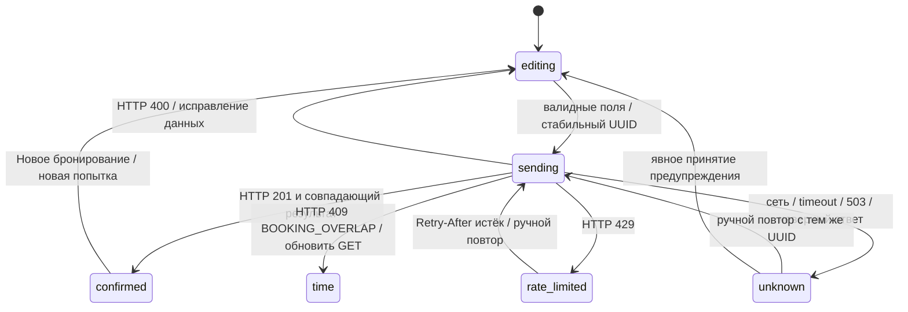

# Пятиэкранный SERVER-клиент — этап 2.4

Основание — актуальный `main` `756c9e153bd52ba1d0e23bdb191005e8e4beaa13` после merge PR №9. Ветка `feat/booking-server-ui-v2.4`. API/SQLite/миграции 0001/0002 не изменены. Один Next.js, без дополнительных backend-компонентов и зависимостей.

## Путь пользователя

1. **Welcome**: прежние логотип, изображение, тексты и кнопка. В SERVER кнопка открывает Calendar. Режим помечен как серверный, без ложного DEMO-подтверждения.
2. **Calendar**: прежние московские даты и окно +3 календарных месяца. Выбор даты запускает GET `/api/availability`, показывает загрузку; успех автоматически открывает Time. SERVER не создаёт demo fixtures и не выдаёт отсутствие ответа за свободный день. Пока API не ответил, сетки нет. Ошибка оставляет календарь доступным, предлагает повтор; можно вернуться на Welcome или выбрать другой день. Старые запросы отменяются и защищены номером поколения от поздних ответов.
3. **Time**: прежние 28 слотов 09–23, легенда, зачёркивание, минимум час, непрерывное расширение/сокращение. Общие `validateInterval`/`selectSlot` не менялись. После «Назад» из Contacts или повторного выбора даты занятость загружается заново. Если выбранный интервал больше не допустим, он сбрасывается с объяснением. Дата и контакты сохраняются. Есть ручное «Обновить доступность»; агрессивного опроса нет. Последний POST остаётся решающей проверкой гонок.
4. **Contacts**: три прежних поля. Общий валидатор нормализует телефон. При отправке синхронный ref и блокировка элементов исключают двойной POST; надпись показывает отправку. Контакты не стираются при ошибке. Только подтверждённый ответ API переводит на Confirmation.
5. **Confirmation**: дата/время/продолжительность и UUID, сообщение о сохранённой брони. Имя/телефон здесь не выводятся. Контакты и payload попытки очищаются из клиентского состояния после успеха. Нет отмены, изменения или ложного сообщения об уведомлении. «Новое бронирование» начинает путь с Welcome.

Контакт администратора остаётся на прежних местах; пока используется согласованная заглушка. Дизайн, цвета, фото и структура пяти экранов сохранены; добавлены только необходимые сообщения/состояния и перенос длинного UUID на узком экране.

## Состояния отправки



`unknown` означает **неизвестный результат**, а не отсутствие записи. Переход в confirmed возможен только после HTTP 201 с ожидаемыми bookingId/status/resource/date/start/end. Ошибочная/оборванная JSON-выдача не считается успехом. Тайм-аут клиента — 10 секунд, без автоматических повторов. Данные и UUID находятся только в памяти текущего экземпляра приложения.

Для одной канонической заявки (ресурс, дата/время, trim имени/фамилии и нормализованный телефон) используется один `crypto.randomUUID()`. Переформатирование того же телефона или пробелы на краях имени не создают новую попытку. После неопределённого результата ручной повтор использует прежний ID; клиент не отвергает такой повтор из-за прошедшего начала, поскольку это может быть уже созданная бронь. Проверку нового запроса выполняет существующая модель.

При unknown поля и переход назад блокируются, чтобы случайное исправление не создало вторую независимую заявку. Кнопка «Изменить заявку после предупреждения» требует явного подтверждения, что первая могла сохраниться. После него фактически изменённый payload получает новый UUID; неизменённый всё ещё повторяет старый. При обычной исправимой 400 осознанное изменение полей также создаёт новый ID. «Новое бронирование» доступно после подтверждения и очищает предыдущую попытку.

**Перезагрузка/закрытие вкладки теряет UUID, поля и незавершённую попытку.** Сохранённая SQLite-запись от этого не удаляется, а уже отправленный POST мог успеть завершиться. После обновления всегда Welcome. Клиент не может восстановить потерянный ID/подтверждение из одной доступности: публичного поиска брони/контактов нет. До определённого результата следует повторять запрос в этой же вкладке, а не перезагружать её. При потере попытки нужна связь с администратором; реальный контакт ещё требуется от владельца. localStorage/sessionStorage/cookies/URL/аналитика для контактов и попыток не используются.

## Ошибки

| Ситуация | Поведение |
|---|---|
| GET сеть/503/неверный JSON | Не показывать свободную сетку. Сообщение и ручной повтор; остальной сайт доступен. |
| GET 429 | Ждать Retry-After перед следующим GET, в том числе при выборе другой даты. |
| POST 409 BOOKING_OVERLAP | Сброс времени, переход Time, свежий GET, дата/контакты сохранены. Ошибка GET не заменяется пустым расписанием. |
| POST 409 ID/cancelled | Без ложного успеха/автоматической смены UUID; объяснение и контакт администратора. |
| POST 400 | Понятная безопасная ошибка данных; поля сохранены, можно исправить/вернуться к дате. |
| POST 429 | Кнопка заблокирована до Retry-After; прежний UUID сохранён, фоновых POST нет. Если до этого результат был unknown, он таким и остаётся. |
| POST 503/сеть/timeout/несовпадающий результат | Сообщение «не удалось подтвердить», та же попытка и безопасный ручной повтор; Confirmation не показывается. Retry-After для 503 также учитывается. |
| POST 403/404 | Безопасное сообщение о недоступном источнике/студии, без SQL и контактов. |

Retry-After принимается и в секундах, и как HTTP-date. Браузер не отражает произвольные технические сообщения сервера, пути или входные данные. Логирования контактов нет. Нормальные 400/429 не утверждают, что более ранняя unknown-попытка точно не сохранилась.

## Архитектура и DEMO

`BookingService` остаётся границей. `createDemoService` — прежние вымышленные данные и recheck; `createServerService` — только same-origin GET/POST, no-store, без серверных импортов. Ресурс по умолчанию studio-19-25, factory принимает другой resourceId; выбора помещений в UI нет. Бизнес-правила и SQL не копируются в HTTP-клиент. Клиент проверяет лишь форму/соответствие ответа и общую UI-валидацию.

Явный build mode выбирает адаптер. Прямая проверка `NEXT_PUBLIC_APP_MODE` позволяет удалить HTTP-транспорт из static DEMO; прежний строгий audit сохраняется полностью. В DEMO нет настоящих API-запросов, SQLite и native dependencies, контакты никуда не отправляются, предупреждения и Confirmation прежние. Node DEMO API отвечают 404. Адрес GitHub Pages и Pages workflow не меняются.

## Локальный запуск

Используйте **тестовую** SQLite, Node 24 LTS и npm; перед обновлением существующей БД следуйте [backup/setup](backend-local-setup.md). Команды из checkout:

```bash
npm ci
npm run db:env
npm run db:init
npm run db:migrate
npm run db:check
npm run dev:server
```

В локальном браузере открыть `http://127.0.0.1:3000`. Это адрес на вашем компьютере, не публичное preview облачной среды. `API_PUBLIC_ORIGIN` по умолчанию совпадает с ним; если используете localhost/другой порт, задайте **точный Origin** в `.env.sqlite.local` и перезапустите Next. `API_TRUST_PROXY=false` для прямого локального запуска; заголовки IP клиент не устанавливает. Настройка будущего публичного proxy — [контракт API](booking-api-v2.3.md), VPS здесь не развёрнут.

Пройти пять экранов с вымышленными «Тест / Пример / +79000000000». Выбрать будущий свободный день, час или 2,5 часа; нажать подтверждение. После успеха записать UUID, обновить страницу, выбрать ту же дату: интервал должен стать занятым. Данные действительно сохранятся в **вашей тестовой БД**, автоматического удаления/публичной отмены нет. Не делать учебные записи на будущей рабочей базе. Оптимизированный запуск — `npm run build:server`, `npm run start:server`.

Автоматическая приёмка не касается локальной рабочей БД:

```bash
npm test
npm run test:integration
npm run typecheck
npm run lint
npm run build:server
npm run test:api:http
npm run test:server:http
npm run test:server:http:failure
npm run test:demo:isolation
npm run test:server:ui
npm run test:server:ui -- --capture-only
```

Нужен Chromium (`/usr/bin/chromium` в этой среде либо `CHROMIUM_PATH` согласно README). Browser runner использует private temp SQLite, реальный production Next на 3014 и собственный static preview на 4174; завершает процессы и удаляет тестовые данные. Проверки последовательные: не пересобирать .next-server/out параллельно. Test proxy mode и документационные IP включены только в тестовом fixture, не выдаются за проверенный VPS/proxy. Для сравнения создаются 20 PNG в `docs/acceptance/v2.4/` — пять экранов × два режима × компьютер/телефон; телефоны замаскированы, контакты вымышленные.

Backend CI сохраняет прежние проверки и добавляет браузер/реальный SERVER+DEMO путь. [Приёмка, результаты, файлы и снимки](acceptance/v2.4/README.md).

## Ограничения

Это локально проверенное подключение интерфейса, не промышленное развёртывание. Сохраняются ограничения API: один процесс/local disk, limiter в памяти с reset при рестарте, общий бюджет без trusted proxy, необходимость HTTPS/proxy/edge limits/backup. Origin не является антибот-аутентификацией. До реальных персональных данных нужно согласовать правовое основание, уведомления/тексты, правила доступа/хранения. Администратор пока без реального телефона. Нет отмены/изменения клиентом, админки, уведомлений, оплаты или VPS. Следующие этапы и merge требуют отдельного согласования.
